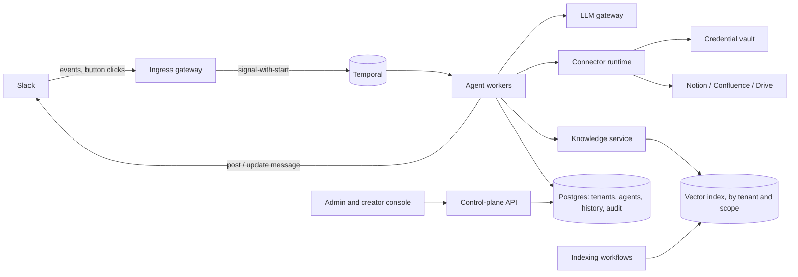
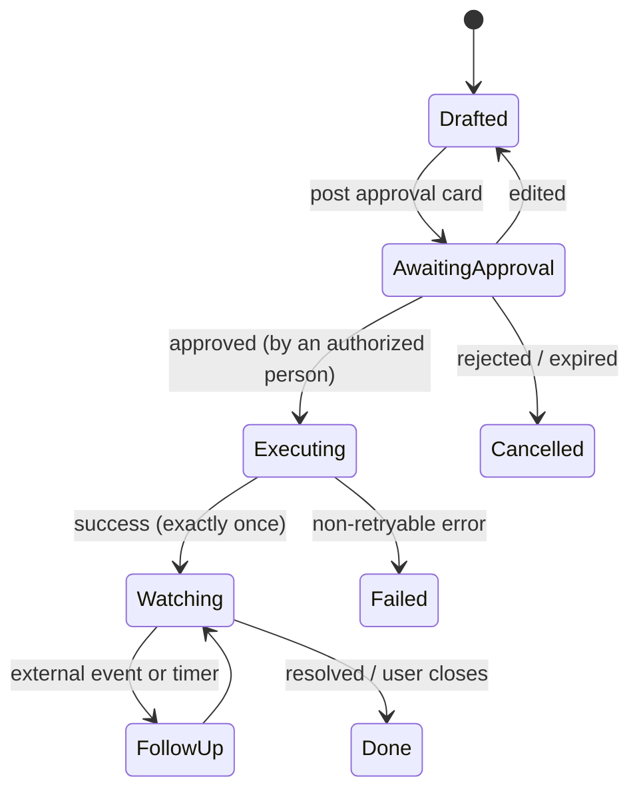

# Architecture

Status: draft · Last updated 2026-11-06 · Product context: [product.md](product.md) · Decisions: [decisions.md](decisions.md)

Design target: **multi-tenant agents that do work.** They take actions, wait for approvals and external events, and follow up over days. Each agent acts within access its creator granted it.

## 1. System overview



| Component | Responsibility |
|---|---|
| Ingress gateway | Verifies Slack signatures, maps the Slack `team_id` to a tenant, drops duplicate events, replies `200` within 3 seconds, and routes each event to the right workflow with signal-with-start |
| Temporal + agent workers | Durable conversations, tasks, approvals, and timers. Workers are stateless and scale horizontally |
| LLM gateway | Hides which model provider is used, applies per-tenant model allowlists, budgets, and rate limits, and records token cost per agent and team |
| Connector runtime | Runs tool calls inside Activities, enforces the agent's grants and the action policy, injects credentials, and attaches idempotency keys |
| Credential vault | Tenant connector credentials (app installs, service accounts), plus per-user tokens only for systems that can't filter by person (D-17); encrypted with a per-tenant key |
| Knowledge service | Retrieval limited to the agent's granted scopes, re-checked against the source, with citations (§6) |
| Indexing | Reads the documents under each granted scope, nightly and on demand (webhooks later), and keeps the index in step with the source (§6). Access is the agent's grant, so no per-user access lists or group membership are synced |
| Control plane | Tenants, agents and their versions, creator roles, policies, audit log queries |

## 2. Multi-tenancy

Tenant = one company = one Slack workspace or Enterprise Grid org.

**Cell architecture.** A *cell* is one complete stack: a Temporal namespace, a set of workers, a Postgres cluster, and a vector index. Each tenant is assigned to exactly one cell. Many small tenants share a cell, and large or regulated tenants can get a dedicated one. A customer-hosted deployment on the roadmap is just a single-tenant cell running in the customer's cloud account, so we don't need a second architecture for it.

Inside a shared cell:

| Layer | Isolation mechanism |
|---|---|
| Temporal | Every workflow ID starts with the tenant ID, plus a `tenant_id` search attribute. Payloads are encrypted by a payload codec using the **tenant's own KMS key**. Rate limits per tenant stop one tenant from starving the others |
| Postgres | `tenant_id` on every row, enforced by row-level security. Queries run with the tenant set on the session, so a missing `WHERE` clause can't leak data |
| Vector index | pgvector tables in the cell's Postgres, so the Postgres row applies: `tenant_id` on every row, and every search filters by tenant and the agent's granted scopes inside the query itself, never on results afterwards. A tenant that needs physical separation gets a dedicated cell |
| Vault | Per-tenant encryption key. Deleting a tenant destroys its key (crypto-shredding) |
| LLM | Per-tenant allowlist of providers and models, optional bring-your-own API key, and a monthly budget limit |
| Audit and logs | Tagged with the tenant. No document content is written to application logs |

## 3. Workflow model

Conversations and tasks are separate workflows, because **a conversation ends but the work it started does not.**

| Workflow | ID | Lifetime | Responsibility |
|---|---|---|---|
| `ConversationWorkflow` | `{tenant}:conv:{slack_channel}:{thread_ts}` | Until the thread is idle for 7 days, then closes. Uses continue-as-new periodically | Turn loop: receive message → LLM → tools → reply. Starts tasks |
| `TaskWorkflow` | `{tenant}:task:{uuid}` | Until the task completes, fails, or expires (days to weeks) | One unit of real work: draft → approval → execute (exactly once) → watch → follow up |
| `IndexingWorkflow` | `{tenant}:index:{scope}` | One run per refresh: started nightly by a Temporal schedule, or on demand | Indexes one granted knowledge scope (§6): reads every page under it, re-embeds what changed, removes what left |

The conversation starts a task as a **child workflow with `ABANDON` as its parent-close policy**, so the task keeps running after the conversation closes. The task posts back to the original thread through activities, and reopens the conversation with signal-with-start if the user replies.

### Turn loop (ConversationWorkflow)

Rules that apply to every turn:
- Messages arrive through a signal handler into an inbox, with duplicates dropped by Slack event ID.
- Agent config is loaded at the start of each turn and pinned to an agent *version*. Edits apply from the next turn onward, and the audit log records which version answered.
- Chat history lives in Postgres. The workflow only carries a reference to it and a turn counter, which keeps Temporal history small and keeps document content out of it. Tool output text is written to Postgres by the activity that ran the tool; the workflow passes only a reference, and an activity puts the text into history. Each history append carries a key built from the Slack event ID and the turn step, so a retried append never stores a message twice.
- Each turn has a maximum number of steps and a token budget. On the last step the model's tool calls are not run: each gets an error result, and the reply says the step limit was reached, so nothing is started that the reply then calls unfinished.
- History is repaired and windowed every time it is loaded for the LLM. A tool call left without a result gets an error result, so one broken turn can't make every later call fail. Past a size budget the oldest turns are dropped, cutting only at a user message that carries no tool results.
- When a turn fails, only the tool calls that did not complete are marked as not completed; a call that already produced a result, such as a write task whose approval card went out, keeps it. A turn that fails before its placeholder is posted still tells the user it failed.
- Multiple tool calls from one LLM response run in parallel and are matched back to the model by their tool-call IDs.
- **Front door.** An agent whose config lists `specialists` is a front door. Its tool list gets `hand_off`, whose only allowed values are those specialists, each described to the model by its config `description`. The hand-off runs no activity: once the step's results are stored, the workflow loads the specialist, posts "<name> here, picking this up." once, and the specialist answers the same message with its own grants, context and step budget, on the same placeholder. The thread's agent is workflow state and carries over continue-as-new, so later messages go to the specialist; a specialist cannot hand off. Its history appends carry an `h1:` key prefix so they never collide with the front door's. A hand-off is allowed on the front door's last step. Threads with no hand-off issue the same commands as before. Asking whether the asker may reach the specialist waits on the console's audience settings.
- Every activity has explicit timeouts and a retry policy. Errors like 4xx, auth failures, and policy denials are non-retryable.

```python
@workflow.defn
class ConversationWorkflow:
    def __init__(self):
        self.inbox: deque[InboundMessage] = deque()
        self.seen = BoundedSet(500)

    @workflow.signal
    def message(self, m: InboundMessage):        # event_id, user_id, text, channel_kind
        if m.event_id not in self.seen:
            self.seen.add(m.event_id)
            self.inbox.append(m)

    @workflow.run
    async def run(self, conv: ConversationRef):
        while True:
            try:
                await workflow.wait_condition(lambda: bool(self.inbox), timeout=IDLE_TIMEOUT)
            except asyncio.TimeoutError:
                return  # tasks keep running; a new message restarts this workflow
            m = self.inbox.popleft()
            ctx = TurnContext(tenant=conv.tenant, user=m.user_id, channel_kind=m.channel_kind)

            agent = await act(load_agent_version, conv.agent_id)
            await act(append_history, conv.history_ref, user_turn(m))
            placeholder = await act(post_thinking, conv, idem=f"{m.event_id}:ph")

            for step in range(agent.max_steps):
                resp = await act(call_llm, agent.version, conv.history_ref, ctx)
                if not resp.tool_calls:
                    await act(finalize_reply, placeholder, resp.text, idem=f"{m.event_id}:reply")
                    break
                results = await asyncio.gather(*[self.dispatch(ctx, agent, tc) for tc in resp.tool_calls])
                await act(append_history, conv.history_ref, results)

            if workflow.info().is_continue_as_new_suggested():
                workflow.continue_as_new(conv, self.inbox)

    async def dispatch(self, ctx, agent, tc):
        policy = agent.policy_for(tc.name)                 # read | write
        if policy.kind == "read":
            return await act(run_connector, ctx, agent.grants, tc)  # agent's grants; ctx.user for audit
        task = await workflow.start_child_workflow(        # writes become durable tasks
            TaskWorkflow.run, TaskSpec(ctx, agent.version, tc),
            id=f"{ctx.tenant}:task:{workflow.uuid4()}",
            parent_close_policy=ParentClosePolicy.ABANDON)
        return ToolResult(tc.id, f"Task {task.id} created; awaiting approval from the user.")
```

`act(...)` is shorthand for `workflow.execute_activity` with the activity's standard timeout and retry options.

## 4. Actions, approvals, and follow-up (TaskWorkflow)

This is where shape 3 lives.



**Action policy.** Every tool has a risk class, set by the connector author and adjustable by the tenant admin:

| Class | Example | Default policy |
|---|---|---|
| `read` | Search Confluence, read a Notion page | Auto, within the agent's grants |
| `write_reversible` | Comment on a Notion page | Ask the requesting user |
| `write_irreversible` | Add a Notion database item, submit time off, send an email | Ask the requesting user. An admin may require a second approver |

Creators can make a policy stricter but never looser than the admin's ceiling.

**Approvals.**
- An approval is a Slack interactive card whose payload carries `task_id` and an approval nonce. The click arrives at the gateway, which sends it to the task workflow as a signal.
- The workflow checks that **the person who clicked** is an authorized approver. It doesn't trust which channel the click came from.
- Approvals expire (default 72 hours) and send reminders using durable timers.
- The approved payload is frozen. If the user edits the draft, they have to approve again, so what was approved is exactly what runs.

**Exactly-once execution.**
- Each write carries an idempotency key, `{task_id}:{step}`. Connectors pass it on where the target system supports one. Where it doesn't, the connector looks for a marker (a label or custom field holding the key) before creating anything.
- An activity retry after a timeout therefore can't create a second item.
- Editable fields are capped below the target system's limits (Notion takes 2,000 characters per text item; details and comments are capped at 1,900 so the signature fits), so an approved payload can't be rejected for its size.
- If a step fails after the user was told the task is in hand, the task posts a line in the thread saying so instead of failing silently. While watching, a transient failure is retried on the next poll; a permanent one (the item is gone or no longer granted) ends the watch with a message.

**Watching and follow-up.**
- Prefer webhooks from the target system. The ingress gateway maps the event to the task and signals it.
- Fall back to polling with backoff, using durable timers.
- Follow-up rules come from the agent config, for example "nudge after 3 days without movement, ask before nudging". Each follow-up that would *change* something goes through approval again.

## 5. Identity and permissions (D-07)

**Each agent is its own principal with its own access.** The agent doesn't borrow the access of whoever is asking. Its creator grants it access, and the creator is accountable for who can reach it.

### Access grants
- A *grant* is a connector plus a scope plus a list of tools, for example "Confluence, space `IT`, read" or "Notion, database `IT requests`, create_item and add_comment".
- The connector runtime enforces grants inside the activity. A call outside the agent's grants is denied before anything goes out, whatever the LLM asked for.
- **No escalation:** a creator can only grant scopes they can access themselves. This is checked against the creator's own identity when the grant is made, and re-checked every night. If the creator loses access or leaves the company, the grant is suspended and the agent's owner and the admin are notified.
- Publishing an agent, or widening its grants, needs admin approval.

### Credentials
- Agents use **tenant-level connector credentials**: an app install or service account per connector, which the tenant admin sets up once. An agent's grants are a subset of what that credential can reach.
- Credentials are never tied to the creator's personal token, so an agent keeps working when its creator goes on leave.
- The LLM never sees credentials. The worker attaches the agent's grants and the requester from `TurnContext`, never from tool arguments.

### Deployment and audience
- Where a message lands: a DM or a mention in an unmapped channel starts at the tenant's `default_agent` (the front door, when it has one); the agents config can map a channel ID to an agent, and mentions there start at that agent. A running thread keeps its current agent.
- The creator chooses the audience: specific channels, specific groups for DMs, or all employees.
- When deploying, the creator sees a summary and confirms it, and that confirmation is recorded: "312 members, including 4 external guests, will be able to see content from: Confluence `IT`, Notion `IT requests`."
- **Audience changes are watched.** Slack membership events (someone joins, the channel is shared via Slack Connect, it's converted to public) trigger a re-check. By default, a new external guest or Slack Connect share **pauses the agent in that channel** until the creator confirms again.

### Writes and attribution
- Writes run as the agent's identity. The requester is recorded in the target system where possible, for example in a "Requested by" person property in Notion or with "on behalf of Priya" in the description, and always in the audit log.
- Approval is still required by default (D-11). The requester approves; a creator can also require a specific approver for each action.

### Requester-scoped data (D-17)
Some questions are about the requester's own records ("my open requests", "my PTO balance"). With an agent-level credential the agent can technically read *everyone's* records, so the runtime must not rely on the LLM to filter by person.

- **Pinned arguments (default).** Tools marked `requester_scoped` in the manifest have their person field (such as "Requested by" or employee ID) filled in by the runtime from the requester's Slack identity. The field is removed from the schema the LLM sees, so the LLM can't set it. Results are answered in the conversation where they were asked. The audience rule (D-07) already covers who can see them: everyone in a channel the agent serves may see what the agent can reach. Pinning is about correctness ("my" is always the asker), not confidentiality.
- **Identity mapping.** The runtime maps the Slack user to the target system's user by verified email, and the result is cached per tenant. If there's no match, the tool returns `unknown_requester` instead of guessing.
- **User delegation (exception).** Only for systems whose API can't filter by person: those tools use the requester's own OAuth token (a *Connect* button) and answer only in a DM.

## 6. Knowledge retrieval

Agents answer from documents their creator granted, and every answer cites its sources.

**Scopes.** A grant names a root, and everything under it is one *scope*. In v1 the root is a Notion page: the page and every sub-page beneath it, at any depth, including sub-pages inside toggles or columns. Confluence spaces and Drive folders become scopes the same way. The company-wide knowledge base is a set of scopes the admin makes available to every agent, such as the all-staff handbook.

**Ingestion.**
1. One `IndexingWorkflow` per (tenant, scope) walks the tree from the root with the tenant's connector credential, a couple of pages at a time to stay under the source's rate limits. Workflow history carries only page IDs and counts; each page is fetched, split into chunks, embedded and stored inside one activity.
2. Each page's content hash includes the embedding model, so unchanged pages are skipped, and changing the model re-embeds everything on the next run.
3. Pages that left the tree, were trashed or can no longer be read are removed from the index.
4. Every indexing run checks that its scope is still granted before any connector call. The nightly schedule deletes the stored pages and chunks of scopes no longer granted to any agent.
5. A Temporal schedule refreshes every granted scope nightly, and an operator command starts a refresh on demand. Updates driven by source webhooks come later.

**Embeddings** sit behind one interface that calls any OpenAI-compatible embeddings endpoint: a hosted provider in production, or a local model for development. The vector size is fixed by the index column (1024), so every model must produce that size.

**Query.**
1. Each query is filtered *inside* the vector search to the tenant and the scopes in the agent's grants. Because grants are per agent rather than per user, the filter is small and cacheable, and we don't need to track every employee's group membership.
2. Before the top results go to the LLM, each page is checked against the source again: it must still exist, not be trashed, and still sit under the granted root. The check walks up the page's parents (pages, and blocks such as toggles); any parent it can't follow drops the page. A page deleted or moved out of a granted scope since the last refresh never reaches the model.
3. Retrieved text is wrapped as *untrusted data* in the prompt (see §8), and the system prompt tells the model never to follow instructions inside it.

**Citations.** Each passage reaches the model with a number. The model cites by number only, like `[2]`; it never writes a link. When the reply is posted, the runtime looks up each cited page's title and link in the index and adds a Sources line. Numbers are unique for the life of a thread, including across continue-as-new, so a number cited in a later turn still means the page it meant when it was first shown. A number that matches nothing gets no link.

## 7. Connectors

- **MCP as the connector contract** (D-08). Each connector is an MCP server describing its tools with JSON Schema. Our connector runtime is the MCP client, running inside Temporal activities. It adds what MCP doesn't provide: credential injection, grant enforcement, risk class, idempotency, audit, and per-tenant rate limits.

### Connectors are mostly configuration, not code (D-15)
Calling a tool is generic: any MCP server, or any REST API with an OpenAPI spec through a generic adapter, works without connector-specific code. What makes a tool safe for agents that *do work* is metadata, so each connector ships a **manifest**:

```yaml
connector: notion
source: mcp://vendor-official            # or openapi://…, or our own MCP server
grant_scopes: [database, page]           # what a grant can be limited to
tools:
  search:          { risk: read }
  query_my_items:  { risk: read, requester_scoped: { property: "Requested by" } }   # D-17
  create_item:
    risk: write_irreversible
    idempotency: { method: marker_field, property: "Agent request ID" }   # query before create
    attribution: { person_property: "Requested by", value: requester }
    watch: { webhook: page_properties_updated, poll_fallback: 15m, done_when: { property: "Status", in: [Done] } }
  add_comment:     { risk: write_reversible, idempotency: { method: marker_text } }
index: { documents: pages_in_granted_scopes }   # how to ingest for knowledge
```

Property names such as "Status", "Done", and "Requested by" differ per database. The creator maps them when granting the agent a database. The mapping is stored by the system's stable property IDs, so a rename doesn't break the agent; names are kept only as labels. The runtime checks the mapping against the live schema (each property exists, has the expected type, and the done values are real options) before the agent starts, and refuses to run a grant that fails. Webhook event names are to be confirmed against Notion's API docs during implementation.

Connectors come in two tiers:

| Tier | Who writes the manifest | What's guaranteed |
|---|---|---|
| Certified | Us: manifest plus integration tests against a real instance | Exactly-once writes, follow-up tracking, attribution |
| Custom (v2) | Tenant admin, for any MCP server or OpenAPI spec | All writes default to `write_irreversible` with approval. **Writes are never retried automatically** without a declared idempotency method; a failure goes back to the user instead of risking a duplicate. No follow-up tracking unless `watch` is declared |

So adding a new system usually means writing and testing a manifest, not a whole integration. Certified write actions still get built and tested one by one, because "exactly once" and "tell me when it's done" depend on how each system behaves.

- Certified connectors for v1: Confluence, Google Drive (knowledge), Notion (knowledge and the first write action).

### Notion specifics for v1 (D-13)
- **Access model fits grants well.** A Notion integration only sees pages and databases a workspace member has explicitly shared with it. The tenant admin installs our integration once, and agent grants are subsets of what's shared with it.
- **No native idempotency key.** Every created item gets a hidden "Agent request ID" property. Before creating, the connector queries for that ID, so a retry finds the existing item instead of creating a second one.
- **Low rate limits.** Notion's API allows only a few requests per second per integration. The connector runtime queues and rate-limits per tenant, and bulk indexing runs in the background at low priority so it never blocks interactive requests.
- **Follow-up** watches the mapped "Status" property through webhooks, with polling as a fallback.
- Admin-added custom connectors (v2) run in a sandbox with no network access beyond the host they declared.
- The agent framework stays a thin custom loop. No LangChain, LangGraph, or CrewAI (D-04).

## 8. Safety

- **Prompt injection.** Content from tools and documents is marked untrusted in the prompt. More importantly, the architecture doesn't depend on the model behaving: write actions *always* need approval by an authorized person, show the exact payload, and can only reach what the agent's grants allow. An injected instruction can at most propose an action the user then sees and rejects.
- **Limits:** maximum steps per turn, token budget per turn, per tenant, and per agent, and a cap on actions per task.
- **Kill switches:** disable an agent, a connector, or all write actions for a tenant immediately. Workers check this inside activities.

## 9. Slack integration

- One distributed Slack app (Events API + interactivity + OAuth install), listed on the Slack Marketplace.
- The 3-second rule: the gateway acknowledges first and then signals Temporal. Slack retries are dropped as duplicates by event ID.
- Responsiveness: post a "thinking…" placeholder or assistant-thread status immediately, update it with progress ("Searching Confluence…"), and replace it with the final answer.
- Slack posts are at least once. The posted message's `ts` is kept under an idempotency key, and a retry that finds it uses the existing message instead of posting again. Slack has no idempotency key of its own, so a crash between Slack accepting a post and the `ts` being recorded can repeat the post; a pending marker written before each post makes such a duplicate visible in the logs. Closing that window would need channel-history read scopes, which the app deliberately doesn't request.
- The model writes Markdown, which Slack doesn't render. Replies are converted to Slack's mrkdwn when they are posted; code, links and citation numbers pass through unchanged, and stored history keeps the model's Markdown.
- Text the runtime didn't write itself (the model's, the requester's, a Notion title) has `&`, `<` and `>` escaped before it is posted, in replies, approval cards and thread lines. Slack reads `<...>` as mentions and links, so without this a page the model read could make it ping a channel or show a link whose text hides where it goes.
- Inbound message text is decoded once, in the gateway: Slack's `&amp;`, `&lt;` and `&gt;` become the characters the user typed, and links become their label, or `label (url)` when the user gave one. Mentions stay as Slack markup. The model and stored history see what the user wrote, not Slack's wire format.

## 10. Data and storage

| Data | Store | Notes |
|---|---|---|
| Tenants, agents, agent versions, policies | Postgres | Agent versions are immutable once published |
| Conversation history | Postgres (blob storage for large tool outputs) | Retention configurable per tenant. Tool output text is stored next to it, keyed by tool-call ID, and never passes through Temporal |
| Audit log | Append-only table, exportable to the tenant's security monitoring system | Who, agent version, identity used, tool, inputs, outputs (or a hash of them), approver |
| Indexed knowledge | pgvector in the cell's Postgres: one row per page (title, link, content hash) and one per chunk (text, embedding), keyed by tenant, scope and page | Searches filter by tenant and granted scope inside the query |
| OAuth tokens | Vault | Per-tenant key |
| Temporal history | Temporal | Encrypted with the tenant key; holds only references and small values |

## 11. Operations

- **Workflow versioning:** Temporal Worker Versioning. Keep workflow code small, put logic in activities, and use continue-as-new so long-running workflows pick up new code.
- **Observability:** OpenTelemetry traces through the gateway, workflow, activities, LLM, and connectors, tagged with tenant and agent. Dashboards for cost and latency per tenant.
- **Evals:** each agent version can have a test set. Creators run it before publishing, and we run regression tests on prompt and model changes.

## 12. Connector health and self-repair (roadmap, D-16)

Custom connectors (D-15) are untested when they're added, so they will fail. This section describes how failures are caught and, later, fixed by a coding agent working inside strict limits.

### Which failures can be fixed with code

| Cause | Route |
|---|---|
| Wrong manifest: field mapping, schema, missing idempotency declaration | Coding agent |
| Bug in a connector server we own | Coding agent |
| Bug in a vendor's or tenant's MCP server | Fix-up layer in our wrapper if possible, otherwise report to the owner. We never change code we don't own |
| Expired login, missing permission, rate limit, target system down | Admin notification or normal retries. Never the coding agent |

### RemediationWorkflow

```
Connector failures ──signal-with-start──▶ RemediationWorkflow
                                            ID = {cell}:remediate:{connector}:{failure_signature}
  1. Circuit breaker: pause writes on the connector (reads continue), notify the tenant admin
  2. Classify the cause → not fixable with code? route as in the table above and stop
  3. Build a redacted failure bundle (see below)
  4. Coding agent activity: long timeout, heartbeats, runs in a sandbox, pushes to a branch
  5. Verify: contract tests, replay of recorded redacted traffic, read-only checks against the live system
  6. Human approval (signal; may wait days): tenant admin for a custom connector, our team for a certified one
  7. Canary rollout → watch error rate on a durable timer → promote, or roll back automatically
  8. Re-enable writes; ask users whose tasks were stuck to approve again
```

Using the failure signature (connector, tool, error class, and the shape of the request) in the workflow ID means many identical failures start **one** remediation. Later failures with the same signature are signals to the existing workflow and only add to its evidence.

### Rules
- **Failed writes are never replayed automatically.** A write that failed may have partly succeeded. After a fix, stuck tasks resume only after the requester approves again.
- **Safety fields are locked.** The coding agent can't change risk class, approval policy, grants, or idempotency declarations. A change to any of them fails verification and needs a human to make it.
- **Tenant isolation.** The failure bundle contains error messages, schemas, and the *shape* of requests and responses, with values redacted and no record contents. A fix for a custom connector deploys only to the tenant that owns it. Sharing it with others means promoting it to a certified connector, which we review.
- **The agent never deploys.** Only the pipeline deploys, with credentials the agent never has, and only after verification and approval.

### Boundaries for the coding agent
- It runs in a **separate platform-operations cell and cloud account**, never in a tenant cell.
- Each run gets a **throwaway sandbox** (a microVM or gVisor) that is destroyed afterwards.
- **No production credentials.** Network access is limited to the git host, a package mirror, and sandbox or recorded test targets.
- **Read** access: the redacted failure bundle and connector source. **Write** access: its own branch only.
- Every run is recorded (prompt, actions, diff, test results) in the platform audit log.

### Staged rollout
1. **v2:** classification, circuit breaker, and failure reports to the admin. No coding agent yet.
2. **v3:** the coding agent proposes fixes; a human approves every deploy.
3. **Later:** automatic deploy only for manifest-only fixes to `read` tools, once the record of approved fixes supports it. Fixes to write tools always need a human.
