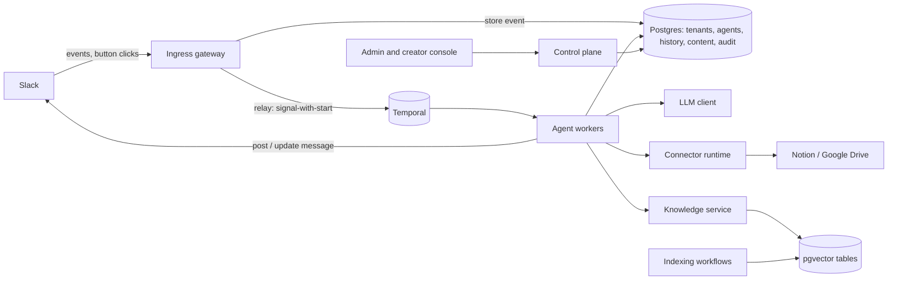
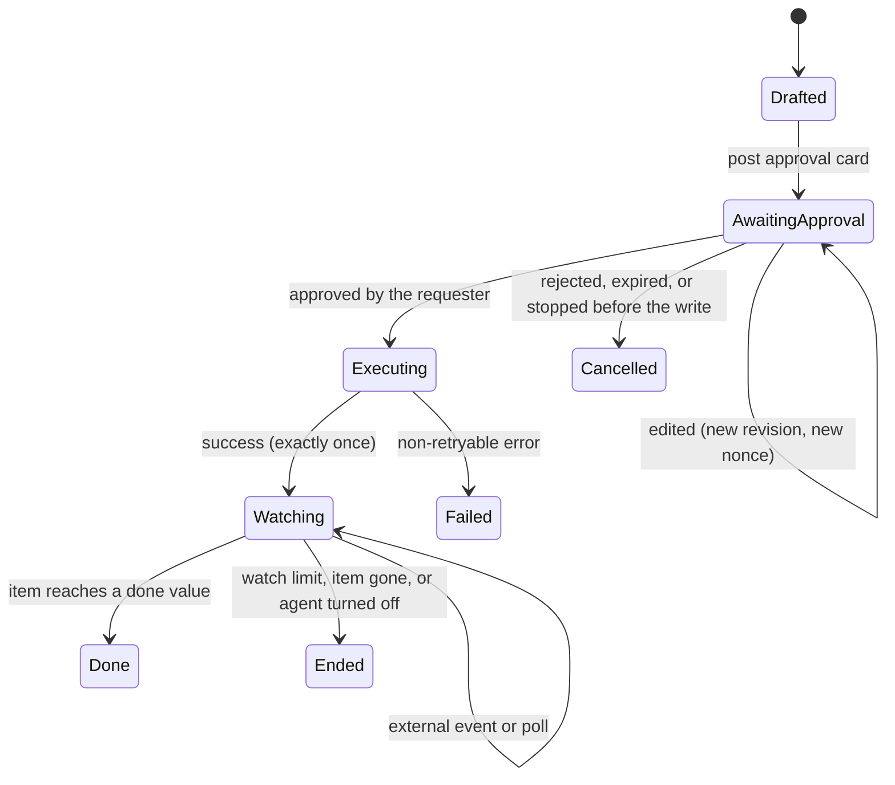

# Architecture

Status: draft · Last updated 2026-11-21 · Product context: [product.md](product.md) · Decisions: [decisions.md](decisions.md) · What is built: [status.md](status.md) · Module map: [modules.md](modules.md) · Running it: [operations.md](operations.md)

Design target: **multi-tenant agents that do work.** They take actions, wait for approvals and external events, and follow up over days. Each agent acts within access its creator granted it.

How to read this document. Every section opens with a status line. Text in the present tense describes code that exists. What is designed but not in the code is under a **Target:** label or in a "Not built yet" list, and [status.md](status.md) lists each capability as `built`, `partial` or `target`. A difference between the code and a present-tense sentence here is a defect to report, not a plan.

## 1. System overview

Status: **built**, except the credential vault, per-tenant rate limits and model allowlists (target).



Target, not in the diagram because it does not exist: a credential vault between the connector runtime and the systems it calls (tenant connector secrets are environment variables named in the tenant's settings, except the Slack bot token and the Notion token, which come first from the tenant's encrypted credential rows, D-34, D-36). Google Drive (read and write) is built behind the connector runtime (D-45, D-46, D-47, D-48, D-49, D-50).

| Component | Responsibility |
|---|---|
| Ingress gateway | Verifies Slack signatures, maps the Slack `team_id` to a tenant and stores each message event in Postgres (`inbound_events`, one row per event ID, so duplicates store nothing) before answering Slack at once. A relay loop in the gateway process then signal-with-starts the thread's workflow with the event ID, retrying with a growing delay until Temporal takes it, so a Temporal outage never loses or repeats a message. Button clicks are handled before the reply, within 2.0 seconds (§9) |
| Temporal + agent workers | Durable conversations, tasks, approvals, and timers. Workers are stateless and scale horizontally |
| LLM client | Hides which model provider is used (Anthropic, or an OpenAI-compatible endpoint such as Qwen) and returns the provider's token counts with each reply. The activity that makes the call prices it with the price in effect that day and records one usage row (§10) per call, by agent, agent version and model; an agent's optional `team` label groups cost by team. Before the provider is called, the same activity checks the kill switches and the tenant's and the agent's monthly dollar budgets (§8): a stopped agent returns a fixed answer, calls no model and records no usage row. A reached tenant budget also stops indexing's embedding calls. Target: per-tenant model allowlists, rate limits and bring-your-own keys |
| Connector runtime | Runs tool calls inside activities, enforces the agent's grants, screens each call against the connector manifest (`read` runs at once; any write becomes an approved task) and attaches idempotency keys. The Slack bot token and the Notion token are read from the tenant's encrypted credential row first, else the environment; Google Drive runs as a per-tenant service account whose short-lived token the deployment key mints (see Credentials, §5; D-34, D-36, D-45) |
| Knowledge service | Retrieval limited to the agent's granted scopes, re-checked against the source, with citations (§6) |
| Indexing | Reads the documents under each granted scope, nightly and on demand, for Notion and Google Drive (D-46), and refreshes a single Notion page within about 30 seconds of a webhook event; a Drive change appears on the next nightly run (§6). Access is the agent's grant, so no per-user access lists or group membership are synced |
| Control plane | Tenants, agents and their versions, creator roles, budgets, kill switches, usage and audit log queries (§5) |

## 2. Multi-tenancy

Status: **partial**. Built: tenant ID in every workflow ID, row and log line, row-level security, per-tenant payload keys held as local files, host variables, or database rows wrapped by a master key, and the Notion webhook token, the Slack bot token, the Notion token and a consented creator's Notion sign-in stored encrypted per tenant (D-32, D-34, D-36, D-40). Target: cells, KMS-held keys, crypto-shredding, `tenant_id` search attribute, per-tenant rate limits, model allowlist and bring-your-own key.

Tenant = one company = one Slack workspace. Many tenants share one deployment (one Temporal namespace, one set of workers, one Postgres); the tenant list lives in the `tenants` table (see D-20 in [decisions.md](decisions.md)).

Inside the deployment:

| Layer | Isolation mechanism |
|---|---|
| Temporal | Every workflow ID starts with the tenant ID (built only in `src/agentos/ids.py`). Payloads are encrypted by a payload codec with the tenant's own key: a local key file, a host variable, or a database row wrapped by a master key, per tenant and version, with the workflow ID as associated data (§10 and D-12). Target: a `tenant_id` search attribute; rate limits per tenant |
| Postgres | `tenant_id` on every row, enforced by row-level security. Queries run with the tenant set on the session, so a missing `WHERE` clause can't leak data. The app connects as a role that bypasses nothing. One exception: the app role may read every tenant's row in `tenant_payload_keys`, because the payload codec decrypts before a tenant is set; those rows are wrapped by a master key the database never holds (D-33) |
| Vector index | pgvector tables in the same Postgres, so the Postgres row applies: `tenant_id` on every row, and every search filters by tenant and the agent's granted scopes inside the query itself, never on results afterwards |
| Slack, Notion and Drive clients | One client per tenant, built from the token the resolver returns (the Slack bot token and the Notion token from the tenant's encrypted credential row first, else the environment variables the tenant's settings name, D-34, D-36); Google Drive runs as the tenant's own service account with a short-lived token the deployment key mints, never another tenant's (D-45). One tenant's client never serves another's work |
| Audit and logs | Tagged with the tenant. No document content is written to application logs |

**Target: cell architecture** (D-03). A *cell* would be one complete stack: a Temporal namespace, a set of workers, a Postgres cluster, and a vector index. Each tenant is assigned to exactly one cell; many small tenants share a cell, and large or regulated tenants get a dedicated one. A customer-hosted deployment on the roadmap is a single-tenant cell running in the customer's cloud account. Today there is one cell.

**Target: vault and per-tenant LLM policy.** A vault holding a per-tenant encryption key, with crypto-shredding when a tenant is deleted; a per-tenant allowlist of providers and models and an optional bring-your-own API key. The monthly budget limit (§8) is built.

## 3. Workflow model

Status: **built**. Not built yet: a token budget per turn and a cap on writes per task (§8).

Conversations and tasks are separate workflows, because **a conversation ends but the work it started does not.**

| Workflow | ID | Lifetime | Responsibility |
|---|---|---|---|
| `ConversationWorkflow` | `{tenant}:conv:{slack_channel}:{thread_ts}` | Until the thread is idle for 7 days, then closes. Uses continue-as-new when Temporal suggests it | Turn loop: receive message, call the model, run tools, reply. Starts tasks |
| `TaskWorkflow` | `{tenant}:task:{uuid}` | Until the task completes, fails, or expires (days to weeks). The watch continues as new when Temporal suggests it or the run's history reaches 1000 events; the next run is handed a `WatchState` of IDs, times and flags (the item's page ID and last status, never a title, comment or link), and a burst of pokes is answered at most once per 60 seconds | One unit of real work: draft, approval, execute (exactly once), watch, follow up |
| `IndexingWorkflow` | `{tenant}:index:{scope}` | One run per refresh: started nightly by a Temporal schedule, or on demand | Indexes one granted Notion knowledge scope (§6) |
| `DriveIndexingWorkflow` | `{tenant}:drive-index:{scope}` | One run per refresh: started nightly by a Temporal schedule (one per Drive scope, ensured by the worker), or on demand. Continues as new for large folders, carrying the walk's IDs and counts | Indexes one granted Drive scope — a folder, a file or a shared drive (§6, D-46) |
| `PageRefreshWorkflow` | `{tenant}:page-refresh:{page}` | Until its page has been quiet for 30 seconds | Refreshes one page after Notion webhook events (§6) |
| `AudienceWatchWorkflow` | `{tenant}:audience-event:{event}` | One activity, then done | Pauses agents in a channel shared with another organisation (§5) |
| `RetentionWorkflow` | `{tenant}:retention` | One run per night, started by a schedule | Purges one tenant's expired rows, a batch per activity (§10) |
| `CreatorAccessWorkflow` | `{tenant}:creator-access` | One run per night, started by a schedule the worker ensures (05:00 UTC, overlap skipped); one activity per published agent, then the combined health check | Re-reads each picked grant with its creator's stored sign-in; an object the creator lost suspends the agent through agent health (§5, D-40) |
| `TestRunWorkflow` | `{tenant}:test-run:{uuid}` | One run of a draft version's test cases, on its own task queue; a one-hour execution timeout, and the run's row always closes | Runs each case as a turn against the draft with the draft's grants; a write stops at the drafted action, nothing posts to Slack (§11, D-44) |

The conversation starts a task as a **child workflow with `ABANDON` as its parent-close policy**, so the task keeps running after the conversation closes. The task posts back to the original thread through activities.

Where in code: `src/agentos/workflows/`, `src/agentos/activities.py`, `src/agentos/ids.py`.

### Turn loop (ConversationWorkflow)

Intent: each Slack message becomes one turn, and a turn leaves history valid whether it succeeds, fails or is refused.

- Messages arrive through a signal handler into an inbox of event IDs (no text), with duplicates dropped by Slack event ID. The workflow reads the text from Postgres.
- Agent config is loaded at the start of each turn and pinned to an agent *version*. Edits apply from the next turn onward, and the audit log records which version answered.
- Chat history lives in Postgres. Temporal history carries only references and small values: the message text (`inbound_events`), each model reply (`model_steps`), each tool call's input (`tool_inputs`), tool output text (`tool_outputs`) and a task's draft (`task_drafts`, one row per revision) are stored by the activity that handles them, and the workflow passes IDs, a turn counter, whether a message had text, a tool call's name and an input hash. Each history append carries a key built from the Slack event ID and the turn step, so a retried append never stores a message twice.
- A conversation or task that was running when content left history keeps its earlier shape until it ends, so histories recorded before the change still replay (D-26). Only messages signalled by the gateway before the change carry their text, and a turn is entirely one shape or the other.
- Each turn has a maximum number of steps. On the last step the model's tool calls are not run: each gets an error result, and the reply says the step limit was reached, so nothing is started that the reply then calls unfinished.
- A reply the model cut off at its token limit is posted with a note when it is text. When it has tool calls, none runs and each gets an error result asking for less.
- History is repaired and windowed every time it is loaded for the LLM. A tool call left without a result gets an error result, so one broken turn can't make every later call fail. Past a size budget (120,000 characters of JSON, about 30k tokens) the oldest turns are dropped, cutting only at a user message that carries no tool results. The window is selected in SQL from a stored per-message `char_len`, so a long thread is not loaded whole.
- When a turn fails, only the tool calls that did not complete are marked as not completed; a call that already produced a result, such as a write task whose approval card went out, keeps it. A turn that fails before its placeholder is posted still tells the user it failed. A failed turn never ends the conversation. A turn on the content-refs path that ends before it ingested its message discards the message's stored text, so a turn that failed before ingest leaves nothing in `inbound_events` for the retention purge to clear.
- Multiple tool calls from one LLM response run in parallel and are matched back to the model by their tool-call IDs, which are namespaced at the client so no two replies share one. `search_knowledge` is the exception: searches run one after another in call order, each numbering its kept passages from the thread's next marker, so a reply's citation markers run 1..n with no gaps and continue across turns; the other calls still run in parallel. One reply may start at most the agent's `max_writes_per_turn` write tasks (1 to 10, default 2); the other write calls, and a write repeated in the same reply, get an error result that tells the model so. A tool input that does not fit its schema gets an error result too. There is no cap per task or per tenant.
- A reply is stored in history only after it was shown, so a Slack failure never leaves history claiming the user saw an answer.
- **Front door.** An agent whose config lists `specialists` is a front door. Its tool list gets `hand_off`, whose only allowed values are those specialists, each described to the model by its config `description`. The hand-off itself runs no tool: the workflow loads the specialist, turns the front door's placeholder into "<name> here, picking this up.", posts a new placeholder below it, and only then stores the step's results and switches the thread, so a failure before the switch leaves the thread with the front door and history that never claims a hand-off. Other tool calls in the same response are not run. The specialist answers the same message with its own grants, context and step budget. The thread's agent is workflow state, carries over continue-as-new, and is also stored per thread in the `threads` table and read when a workflow starts, so a thread keeps its specialist when the workflow closes after a week of silence and a later message starts it again. A new thread starts at the front door. A specialist cannot hand off. Its history appends carry an `h1:` key prefix so they never collide with the front door's. A hand-off is allowed on the front door's last step. The front door is offered only the specialists the asker may use in this place and that are not switched off (§5, §8), and no `hand_off` tool when there are none. The workflow checks the chosen specialist again before it switches; a refused hand-off keeps the thread with the front door, the model gets a tool error saying the specialist is not available, and an `audience_refused` event records it.
- Every activity has explicit timeouts and a retry policy. Errors like 4xx, auth failures, and policy denials are non-retryable. Model and embedding calls give up on their own (75 seconds for a model call, 60 for one embeddings request) before their activity's timeout, and the provider SDKs never retry: Temporal retries the activity.
- Workflow code changes that alter the commands of an existing history sit behind `workflow.patched` markers, and recorded histories are replayed in tests (`tests/core/test_replay.py`). `scripts/record_replay_fixtures.py` records them from scenarios, each in a legacy shape (text and payloads inline, from before content left history) and a reference shape (references only), under the encrypting data converter and a fixed test key; old fixtures are kept, since workflows of both shapes can be running. A `patched` marker record is written by the Temporal SDK core outside the payload codec and carries only the patch ID.

```python
@workflow.defn
class ConversationWorkflow:
    def __init__(self):
        self.inbox: deque[InboundMessage] = deque()   # event IDs and small metadata
        self.seen = BoundedSet(500)

    @workflow.signal
    def message(self, m: InboundMessage):        # event_id, user_id, channel_kind; the text is in Postgres
        if m.event_id not in self.seen:
            self.seen.add(m.event_id)
            self.inbox.append(m)

    @workflow.run
    async def run(self, conv: ConversationRef):
        while True:
            try:
                await workflow.wait_condition(lambda: bool(self.inbox), timeout=IDLE_TIMEOUT)
            except asyncio.TimeoutError:
                return  # tasks keep running; a new message restarts this workflow
            m = self.inbox.popleft()
            ctx = TurnContext(tenant=conv.tenant, user=m.user_id, channel_kind=m.channel_kind)

            agent = await act(load_agent_version, conv.agent_id)
            if not await act(check_audience, ctx):           # asker and place, from the runtime
                continue                                    # fixed refusal posted; nothing stored or run
            await act(ingest_message, conv.history_ref, m.event_id)   # text from inbound_events into history
            placeholder = await act(post_placeholder, ctx, idem=f"{m.event_id}:ph")

            for step in range(agent.max_steps):
                out = await act(call_model, ctx, conv.history_ref, step_key)   # reply stored as a model_step
                if not out.tool_calls:
                    await act(finalize_model_reply, placeholder, out, idem=f"{m.event_id}:reply")
                    break
                results = await self.run_calls(ctx, agent, out.tool_calls)  # searches serial (contiguous markers), rest parallel
                await act(append_tool_results, conv.history_ref, results)

            if workflow.info().is_continue_as_new_suggested():
                workflow.continue_as_new(conv, self.inbox)

    async def dispatch(self, ctx, agent, tc):
        if tc.kind == "read":                              # from the connector manifest's risk
            return await act(run_stored_read_tool, ctx, tc)    # agent's grants; ctx.user for audit
        task = await workflow.start_child_workflow(        # writes become durable tasks
            TaskWorkflow.run, TaskSpec(ctx, agent.version, draft_ref),
            id=f"{ctx.tenant}:task:{workflow.uuid4()}",
            parent_close_policy=ParentClosePolicy.ABANDON)
        return ToolResult(tc.id, f"Task {task.id} created; awaiting approval from the user.")
```

`act(...)` is shorthand for `workflow.execute_activity` with the activity's standard timeout and retry options. The listing is simplified: the real loop also handles hand-offs, the step limit, cut-off replies and failures.

## 4. Actions, approvals, and follow-up (TaskWorkflow)

Status: **partial**. Built: approval by the requester, an admin's approval policy per low-risk action, edit, reminder and expiry, exactly-once writes (Notion create and comment; Drive comment, Sheet append, template Doc and section replace, D-47, D-48, D-49, D-50), watch by webhook and polling, a single "no movement" notice and the nudge offer with its approved comment-and-DM (D-41). Not built yet: admin-adjustable risk classes and a second approver.

This is where shape 3 lives.



**Action policy.** Each tool in the connector manifest has a risk class: `read` runs at once within the agent's grants; `write_reversible` (a comment) and `write_irreversible` (a new item, a Sheet row append, a template Doc, a section replace) both become a task that asks the requester to approve, unless an admin turned approval off for that low-risk action (D-43). The manifest's `risk` decides which path a call takes, its `low_risk` flag marks a comment action (today only Notion's `add_comment`; a Drive comment always asks approval, D-47), and its `idempotency` method decides how a write avoids a duplicate; a write whose method no manifest declares is refused. A Drive write — comment, append, template Doc or section replace — is one approval card and one write, with no follow-up watch (D-47, D-48, D-49, D-50).

Built: an admin turns requester approval off per low-risk action on the settings page (D-43). A low-risk action in v1 is a Notion comment on an item the requester filed; it runs without a card only when the policy allows it and the platform's own task records show the requester filed the item. Target: the tenant admin adjusts a class's policy, creators make a policy stricter but never looser than the admin's ceiling, and an admin may require a second approver. The requester is the only approver (D-11, Q-5).

### Approvals

Intent: nothing is written until the requester has seen exactly what will be written and said yes, unless an admin turned approval off for that low-risk action (D-43).

- An approval is a Slack interactive card whose payload carries `task_id` and an approval nonce. The click arrives at the gateway, which sends it to the task workflow as a signal.
- The workflow checks that **the person who clicked** is the requester. It doesn't trust which channel the click came from. A click with another nonce is ignored.
- The payload is frozen before the card is posted, as revision 1 of the task's draft in Postgres. An approval binds to one (revision, nonce), and the write reads that revision. **Edit** stores the next revision with a new nonce and asks again, so what was approved is exactly what runs. A request can be edited up to 5 times.
- A comment may only target an object the agent was granted — a Notion page in a granted database, or a Drive file that is granted itself or sits under a granted folder or shared drive: checked before the card is posted and again before the comment is made (D-47).
- Approvals expire and send one reminder using durable timers. An agent definition sets `expires_after_hours` (default 72, at most 168) and `reminder_after_hours` (default 24); each edit restarts the window.
- **Pending cards do not outlive what let them run.** Just before an approved write, the task checks that the agent is not turned off, the channel is not paused and the requester is still in the audience of the agent's current published version (see §5 and §8). If any fails, nothing is written, the card shows a fixed line and the task ends; a check that cannot be completed stops the write too. A writes or connector switch is applied inside the write activity, before the connector call, and ends the task the same way.
- **A low-risk comment may run without a card** (D-43): when the tenant's policy for the comment action is `none` and the item was filed by the requester — read from the platform's own task records, never from the model — the comment runs as soon as the draft is resolved, still through the agent-effect gate and still exactly once. It is audited as `write` with outcome `policy` and no `approval` row, and the thread line says no approval was needed. Every other write shows the card; a nudge's comment always shows its card (D-41).

Where in code: `src/agentos/workflows/task.py`, `AgentActivities.check_before_write` and the write activities in `src/agentos/activities.py`, `src/agentos/gateway/app.py`.

### Exactly-once execution

Intent: a crash, a retry or two overlapping attempts produce one item and one "Filed" line.

- Each write has an idempotency key — `{task_id}:create` (a new item or a template Doc), `{task_id}:comment`, `{task_id}:append` or `{task_id}:replace` (a section replace). The target systems have no idempotency key of their own (a section replace also locks on the Doc's own revision, D-50), so Postgres decides which attempt writes: an attempt claims the key in `external_writes` with a lease, marks it issued just before it sends the write, and stores the result as soon as the write returns.
- A second attempt that finds a live lease writes nothing and retries later; one that finds a stored result returns it without calling the connector. After a claim that took over from an attempt that had sent the write, the connector looks for its marker a few times before it writes, because the target's search can lag: a hidden "Agent request ID" property or a reference at the end of a Notion comment, a reference at the end of a Drive comment, the appended Sheet row's developer metadata, or the template Doc's appProperty (D-47, D-48, D-49). That lookup is a check, not the guard.
- A section replace carries no marker: the Doc's own revision is the lock (D-50). The write is one Docs `batchUpdate` carrying `writeControl.requiredRevisionId` = the revision the draft read, so a retry after a lost response, or a Doc someone else moved, gets a revision mismatch; the Doc is then read and the section's text compared with the approved text — equal means the earlier attempt landed (done), different refuses ("The document changed since you approved; I'll draft it again") and nothing is written.
- Accepted residual risk: a target whose search lags a write by longer than the look-before-write window gets a second item from the retry.
- When the activity's retries run out, the task looks for the item a few times with timers between. If it is found the task carries on as filed; if not it says it could not confirm and points to the tracker. It never says nothing was filed after retries ran out.
- Editable fields are capped below the target system's limits (Notion takes 2,000 characters per text item; details and comments are capped at 1,900 so the signature fits; a Drive append allows at most 50 columns, each name 200 characters and each cell 1,000; a template Doc at most 50 blanks, each name 200 characters and each value 1,000, with a title of 150; a section replace's new text 2,000 and the section it replaces at most 5,000, D-48, D-49, D-50), so an approved payload can't be rejected for its size.
- If a step fails after the user was told the task is in hand, the task posts a line in the thread saying so instead of failing silently.

Where in code: `AgentActivities._write_once` in `src/agentos/activities.py`, `scripts/migrations/018_external_writes.sql`, `src/agentos/connectors/notion.py`, `src/agentos/connectors/drive.py`, `src/agentos/connectors/google_iam.py` (the revision-locked Docs `batchUpdate`).

### Watching and follow-up

Intent: the task keeps watching the item until its status reaches a done value, and survives restarts.

- A signed Notion webhook event is mapped to the task and signals it. Polling with durable timers (every 15 minutes by default) is the fallback, so a missed webhook costs delay, not correctness.
- A transient failure while watching is retried on the next poll; a permanent one (the item is gone or no longer granted) ends the watch with a message. Turning the agent off ends the watch with no post; turning the connector off makes the poll fail retryably, so the task keeps watching.
- The agent definition sets `stale_after_days` (default 3) and `max_watch_days` (default 30, at most 60). The task posts "No movement on '<title>' in N days." once.
- Built: a stale item offers its requester a nudge of the assignee (D-41) — one approval card previewing both effects exactly, then a Notion comment (mentioning the assignee when matched to Slack) and a Slack DM naming the requester, each exactly once; a failed DM is reported, never re-commented. `follow_up.nudge` (default true), `max_nudges` (default 2), and the stale clock restarts from a nudge that ran. The nudge's comment always shows a card.

Where in code: `src/agentos/workflows/task.py`, `src/agentos/task_notices.py`, `src/agentos/config.py` (`FollowUp`, `Approval`).

## 5. Identity and permissions (D-07)

Status: **partial**. Built: agent-owned grants enforced before every connector call, versions and roles, the audience and its checks, the console and its sign-in, the nightly re-check of a creator's own access with suspension and notification (D-40). Target: tenant connector credentials in a vault, requester delegation, a specific approver per action.

**Each agent is its own principal with its own access.** The agent doesn't borrow the access of whoever is asking. Its creator grants it access, and the creator is accountable for who can reach it.

### Access grants

Intent: an agent can reach only what its creator granted it, and a creator can grant only what they can see themselves.

- A *grant* is a connector plus a scope plus a list of tools, for example "Notion, database `IT requests`, create_item and add_comment".
- The connector runtime enforces grants inside the activity. A call outside the agent's grants is denied before anything goes out, whatever the LLM asked for. A call that names a page by link or ID cannot be checked first, because Notion tells a page's database only when the page is fetched; a page that is missing, unshared or in an ungranted database raises the same error, so the answer never reveals whether an ungranted page exists.
- Grants are read from the published version when a tool runs, not when the worker starts. A grant removed by a new published version applies to the next call, including a write that was approved before. A turn's model calls and its audience check use the version the turn started with, so a publish in the middle of a turn does not change its prompt.
- **No escalation, as built:** a Notion *picker*, only when configured (`NOTION_OAUTH_CLIENT_ID`, `NOTION_OAUTH_CLIENT_SECRET`, `AGENTOS_REQUIRE_GRANT_PICKER=1`). The creator signs in to Notion with a public integration, the console lists what their token can search, and submit refuses a grant that is new since the published version and was not picked there. The creator's Notion token is used once to list and is never stored, unless the creator consents to keep it encrypted for the nightly re-check (D-40). Picks are audited as `grant_pick`.
- **Drive grants (D-46):** a creator picks a folder, a file, a shared drive, a Sheet or a template from what the workspace's Drive address can see — no per-creator Google sign-in and no pick gate. Anything shared with the address is grantable by every creator in the workspace; the admin's publish approval (and the widening acknowledgement) is the check.
- Without the picker only the admin's approval stands in for the check. The version page shows, per grant, the object's live title and parent, a warning when the creator's label and the live title don't contain one another as a run of whole words once normalised (lower-cased, spaces and punctuation collapsed), and a diff of grants and audience against the published version. A version that widens access (a new grant, other properties, a new channel, wider direct messages, guests) is published only with the approver's acknowledgement, which names the published version the diff was computed against, is refused if another was published since, and is audited as `widening_confirm`. A first publish, with nothing to compare with, always widens.
- Publishing an agent, or widening its grants, needs admin approval.
- The grant check (`check-grants`) shows a creator only ok or a problem category per grant and never a schema; an admin sees titles, parents and property detail.
- Built: the nightly re-check of each picked grant against the creator's own identity (D-40). One schedule per tenant runs `CreatorAccessWorkflow`, re-reading each grant its creator picked with that creator's stored sign-in; an object the creator lost suspends the agent through agent health and tells the creator and admins. Without consent the grant is marked "cannot verify", never a suspension.

Where in code: `src/agentos/connectors/notion.py` (`GrantDenied`), `src/agentos/grant_checker.py`, `src/agentos/grant_picks.py`, `src/agentos/notion_picker.py`, `src/agentos/access_diff.py`, `ControlPlane.publish_version` in `src/agentos/control.py`.

### Agent versions, roles and publishing

Intent: what runs is a version an admin approved, and every change to who may do what is recorded with the change.

- Agents live in Postgres as **versions**: `draft`, then `pending` (submitted), then `published`; the version it replaces becomes `superseded`. A pending version can be withdrawn or rejected back to `draft`. A database trigger keeps a published version immutable, allows only those moves, and only one version per agent is published. Publishing a version lower than the published one is refused; a rollback is a new draft from the old version.
- Workers read the current published version on every call, so a publish takes effect on the next message without a restart.
- A tenant starts from its YAML file once: the import copies each agent in as published version 1 and records an `agent_import` audit event. After that the database is the source of truth for agents; editing the YAML afterwards changes nothing. Tenant settings are imported once into the `tenants` table the same way (D-20).
- **Approving is approving a content.** Submit stores the SHA-256 of the definition (`definition_sha256`). A publish must carry the hash the approver was shown and is refused (409 in the API; a missing hash is 422) when the version carries another, which a withdraw, an edit and a resubmit under the same number produces. The `agent_publish` event records that reviewed hash (D-29).
- **Roles.** A tenant's first admins are listed in its config file (`admins:`), or, for an installed tenant, are its installer; they can't be removed or demoted through the app. Admins add other admins and creators, who are stored per tenant. Creators create agents and edit and submit their drafts; only an admin publishes or rejects. An admin may approve their own submission, and the audit event records both. The last admin can't remove or demote themself. A tenant with no admins can publish nothing.
- **A creator reads only the agents they created** (D-30): definitions, versions, usage, budgets and switches follow one rule, enforced in `ControlPlane`; an agent that belongs to someone else answers "not found". Admins read every agent.
- **Grant check.** Before any publish, the control plane reads every database and page the version grants, with the tenant's Notion credential. A grant that is gone, trashed or not shared is a problem and the publish is refused with the list. A network error, rate limit or Notion server error only means "try again" (502 from the API, 503 from a console page): nothing is judged or changed. Anything else, such as a missing tenant key, is a setup error and shows as one. Drive grants are read at submit — a Sheet's header columns, a template's blanks and destination shared drive (D-48, D-49) — and at publish a template's destination folder must sit in a shared drive (D-49).
- **Every change and its audit event commit in one transaction** (a unit of work holding the tenant's advisory lock), so a failed audit insert leaves no change behind and the retry is not refused as "already done". `ControlPlane` holds every role check and writes one audit event per change (`agent_create`, `agent_draft`, `agent_edit`, `agent_submit`, `agent_withdraw`, `agent_reject`, `agent_publish`, `member_add`, `member_remove`, `member_role`, `budget_set`, `switch_off`, `switch_on`, `audience_confirm`, `audience_resume`, `widening_confirm`, `grant_pick`). A refused control-plane action is not audited (refused turns and writes are; see [audit-events.md](audit-events.md)). A retried `new_draft` returns the draft its first attempt made. Three things change state without passing through `ControlPlane`, on purpose: the host operator's switches command (audited as `operator:<OS login>`), the one-time YAML imports (`agent_import`, which run before any admin exists), and the Slack install (`install`, which creates the tenant before any admin exists). Opening an audience pause is the Slack event handler's. Retention limits (`retention_set`) and repricing (`usage_repriced`) are audited by their owner-role commands.
- Row-level security hides other tenants' rows; the two reads that must cross tenants (Slack workspace to tenant, and the list of tenants) go through narrow `SECURITY DEFINER` functions that return the tenant ID, the enabled flag and a change time only.

Where in code: `src/agentos/agent_store.py`, `src/agentos/control.py`, `src/agentos/unit_of_work.py`, `src/agentos/members.py`, `src/agentos/audit.py`, `src/agentos/tenant_store.py`.

### Control plane and console

Intent: the control plane is a separate process from the internet-facing gateway, and every request acts as a verified person.

- It serves a JSON API and server-rendered console pages from the same role layer, so a user's role decides what they can do in both.
- **Without sign-in configured** it listens on loopback only and acts as one fixed operator named at start. No request can name or change the actor. It refuses a non-loopback bind.
- **With Sign in with Slack configured** (Slack's OpenID Connect; client ID, client secret and the console's public `https://` URL) it may listen publicly, but not while the database password is empty or a development default. The signed-in user's Slack team must map to a tenant, the user must have a role there (otherwise a "no access" page and no session), and the session's tenant must equal the tenant in the path.
- Sessions live in Postgres under row-level security: a 256-bit ID of which only the SHA-256 is stored, 8-hour expiry, a cookie that is `HttpOnly`, `Secure` and `SameSite=Lax`. Sign out deletes the row. The JSON API accepts the same cookie for its own tenant's paths.
- **Browser guard.** Requests must carry an allowed `Host` and, when present, an allowed `Origin`. A cross-site request is refused, with two exceptions: Slack's redirect to the sign-in callback, and a top-level page navigation (GET, `navigate`, `document`) to a console page. Every console GET only reads, except the sign-in, install and Notion callbacks, which complete their flow's write; pages can't be framed, and pages are served with a Content-Security-Policy that allows no script and no outside asset. API writes must be JSON; console form posts need the session's CSRF token and the console's own origin.
- Pages never answer 502 or 504, because a proxy such as Cloudflare replaces those with its own page; "Notion couldn't be reached" is a 503 page that says nothing changed. An unknown tenant and a real one get the same answer before sign-in.
- A tenant with no Notion key is admitted Slack-only; its grant checks fail at publish time with a message naming the variable. The process reads each tenant's Slack bot token, on first use, to count an audience's people; a tenant without it shows "could not count" on the version page and can't publish until a token is available (its credential row or the variable).
- Not built yet: the console's connectors page. The tenant-settings page (D-36, D-45) and a test set for agent versions (D-44) are built.

Where in code: `src/agentos/control_api.py`, `src/agentos/web_ui.py`, `src/agentos/slack_signin.py`, `src/agentos/sessions.py`, `src/agentos/control_errors.py`, `src/agentos/templates/`.

### Credentials

Intent: connector credentials belong to the tenant, never to a creator or to the model.

- Agents use **tenant-level connector credentials**: one Notion token per tenant, connected by OAuth in the console and stored encrypted in the database (`tenant_credentials`), resolved from that row first, else the environment variable the tenant's settings name (D-36), and one Slack bot token, stored encrypted per tenant and resolved the same way (D-34) (the tenants table stores the names, never a value). Google Drive uses one service account per tenant, created on Connect, whose short-lived tokens the deployment key mints; no key is stored per tenant (D-45). An agent's grants are a subset of what that credential can reach.
- Credentials are never tied to the creator's personal token, so an agent keeps working when its creator goes on leave. The creator's Notion sign-in for the picker is used once and not stored, unless they consent to keep it encrypted for the nightly re-check (D-40).
- The LLM never sees credentials. The worker attaches the agent's grants and the requester from `TurnContext`, never from tool arguments.
- The Slack bot token, the Notion token, the Notion webhook token and a consented creator's Notion sign-in are encrypted per tenant in the database (D-32, D-34, D-36, D-40); Google Drive stores no per-tenant secret (D-45). Target: a credential vault for the remaining connector secrets, and per-user tokens only for systems that can't filter by person (D-17). Not built.

Where in code: `src/agentos/tenants.py`, `src/agentos/credentials.py`, `src/agentos/drive_connections.py`, `src/agentos/config.py` (`read_secret`, `Settings.require`).

### Deployment and audience

Intent: an agent answers only the people and places its creator and an admin approved, and says so plainly when it refuses.

- Where a message lands: a DM or a mention in an unmapped channel starts at the tenant's `default_agent` (the front door, when it has one); the tenant settings can map a channel ID to an agent, and mentions there start at that agent. A NULL `default_agent` (an installed tenant not set up yet) gets one fixed not-set-up reply, with no model or Notion call. A running thread keeps its current agent.
- **The audience is part of the agent version.** A definition may carry `audience: {channels: [C...], dm: everyone | {user_groups: [S...]}, guests: false}`, edited in the console with the rest of the definition, so a change is a new version that an admin publishes. It holds Slack IDs only. A definition with no `audience` keeps working under a legacy default, because published versions never change: every full member by direct message, the channels the tenant settings map to the agent (the default agent also answers in channels not mapped, and a front door's specialists follow it into the front door's channels), and no guests. The console marks the default "default (no audience set)".
- **Who counts.** "Everyone" is every full member of the tenant's own Slack workspace. Single and multi-channel guests are refused unless `guests: true`. A person from another workspace (Slack Connect: a different `team_id` on the user) and a deactivated user are always refused.
- **Enforced at the start of every turn**, for the thread's current agent, by an activity that gets the asker, the channel and its kind from the Slack event, never from the model. A channel message needs the channel in the audience. A direct message needs `dm: everyone`, or the asker in a listed user group. A refused turn stores nothing, runs no model call or tool, posts one fixed reply ("<agent name> isn't available to you here. Ask <creator> for access.") and records an `audience_refused` event with agent, version, requester and a reason code, never the message. The creator is mentioned in that reply once a day per asker and place, and named without a mention after that (`owner_pings`).
- **Slack lookups** (`users.info`, `usergroups.users.list`, and for the console `conversations.members` and `users.list`, paged) go through the Slack client and are cached per tenant in the worker for five minutes, so a person removed from a group, made a guest or deactivated is refused within five minutes. A transient failure is retried. When the answer can't be had, the turn is refused, never allowed, with its own reply ("I couldn't check whether ... is available to you just now. Try again in a few minutes.") and an `audience_refused` event with outcome `error`.
- **Channel routing stays in the tenant settings.** A publish, and the startup check, refuse an agent that the settings map to a channel its audience leaves out, since every mention there would be refused.
- **Confirmation at publish.** The version page shows the audience in force and counts, live from Slack, the people who can reach the agent: in total, how many are guests and how many are from other workspaces, per channel and for direct messages. The count is of everyone present in the audience's places, so it can overstate (a guest in a listed channel is counted though refused without `guests: true`). Publishing needs the approver to confirm those counts. The API's publish takes `{"confirm_audience": {"total": n, "guests": g, "external": e}}`, and `ControlPlane.publish_version` refuses with 409 when it is missing or no longer matches a fresh count. An `audience_confirm` event records the approver and the three counts. Counting a whole workspace costs one `users.list` call per 200 users; the page may reuse a list read in the last five minutes, a publish always reads again.

Where in code: `src/agentos/audience.py`, `AgentActivities.check_audience` in `src/agentos/activities.py`, `src/agentos/threads.py`, `src/agentos/control.py`.

### Audience changes are watched

Intent: when an agent's channel starts reaching another organisation, the agent stops answering there until its owner has looked. Built, and untested against a real Slack Connect channel (tested only with fakes).

- The one trigger is a channel being shared with another organisation (`channel_shared`). A person joining, guest or not, is not watched: who is added to a channel is the admins' responsibility.
- The gateway verifies the signature as for messages and starts one `AudienceWatchWorkflow` per Slack event, with an ID built from the tenant and the event ID that is never reused, so a Slack retry starts nothing. A `member_joined_channel` event is answered 200 and ignored.
- Its one activity needs no Slack lookup: it pauses every published agent whose effective audience names the channel, in that channel only (reason `channel_shared`). The same trigger while a channel is already paused changes nothing.
- A pause is a row in `audience_pauses` (tenant, agent, channel, reason code, time, who resumed and when); a resumed row stays as history and at most one is active per agent and channel.
- `check_audience` refuses a turn in a paused channel with reason `paused` and one fixed reply ("<agent name> is paused in this channel until its owner reviews who can see it."), so the turn runs no model or tool, in a thread already running as well; direct messages and other channels are unaffected.
- The agent's creator and the tenant's admins get one direct message per pause (agent, channel and reason, no content); the notice and the `audience_pause` audit event have keys built from when the pause began, so a retried activity repeats neither.
- **Pending approval cards stop too** (D-23): the pre-write check (§4) refuses a write when the channel is paused or the requester has left the audience, and the card reads "<agent name> can no longer act for you here; nothing was changed."
- `ControlPlane.paused_channels` (admins and the agent's editors) lists the pauses with a fresh count of the people in each channel, and `resume_channel` (the creator or an admin) needs that count confirmed like a publish; it records `audience_resume`.

Where in code: `src/agentos/audience_watch.py`, `src/agentos/audience_pauses.py`, `src/agentos/workflows/audience_watch.py`, `src/agentos/gateway/app.py`, `scripts/migrations/013_audience_watch.sql`.

### Writes and attribution

Intent: a write runs as the agent, is attributed to the requester, and needs the requester's approval unless an admin's policy allows the low-risk action without it (D-43).

- Writes run as the agent's identity. The requester is recorded in the target system where possible: the "Requested by" person property in Notion when the requester's Slack email matches a Notion user, otherwise a "Requested by <name> via <agent>" line in the item's body, shown on the approval card before approval. The audit log always records the requester.
- Approval is required for every write (D-11), unless an admin turned approval off for that low-risk action (D-43): a Notion comment on an item the requester filed. The requester approves; there is no per-action approver (Target).

Where in code: `AgentActivities._requester` in `src/agentos/activities.py`, `src/agentos/connectors/notion.py`.

### Requester-scoped data (D-17)

Intent: "my open requests" is answered from the asker's own records, and the model can't choose whose.

- **Pinned arguments.** Tools marked `requester_scoped` in the manifest have their person field filled in by the runtime from the requester's Slack identity and removed from the schema the LLM sees. Results are answered in the conversation where they were asked; the audience rule (D-07) already covers who can see them. Pinning is about correctness ("my" is always the asker), not confidentiality.
- **Identity mapping.** The runtime maps the Slack user to the Notion user by verified email, cached per tenant. With no match, `my_items` returns "I couldn't match your Slack email to a Notion user" (`UnknownRequester`) instead of guessing.
- Target: **user delegation**, for systems whose API can't filter by person: the requester's own OAuth token (a *Connect* button), answers only in a DM. Not built.

Where in code: `src/agentos/connectors/manifest.py`, `NotionConnector.my_items` in `src/agentos/connectors/notion.py`.

## 6. Knowledge retrieval

Status: **built** for Notion pages and Google Drive (D-46). Target: a company-wide scope the admin makes available to every agent.

Agents answer from documents their creator granted, and every answer cites its sources.

**Scopes.** A grant names a root, and everything under it is one *scope*. The root is a Notion page: the page and every sub-page beneath it, at any depth, including sub-pages inside toggles or columns, and the rows of any database placed on those pages (a row is indexed as a page of the same grant: its title, its properties as text and its body). Text nested more than five levels inside one page is not indexed. A Drive grant's root is a folder, a file or a shared drive (D-46): a folder is walked recursively, a shared drive from its root, a single file as itself; a Drive file is indexed as a page of the same grant (its ID the page ID, its `webViewLink` the link).

### Ingestion

Intent: the index follows the source, never deletes on weak evidence, and never lets one bad page stop a run.

1. One `IndexingWorkflow` per (tenant, scope) walks the tree from the root with the tenant's connector credential, two pages at a time (this bounds the work in flight; it is not rate limiting) and at most 2,000 pages per scope. Notion's rate limit is a per-tenant token bucket in each worker process (about three requests a second; interactive requests go ahead of bulk work such as indexing and polling), and a 429 is retried by Temporal. Workflow history carries only page IDs and counts; each page is fetched, split into chunks, embedded and stored inside one activity. A Drive scope is walked by `DriveIndexingWorkflow` instead (D-46): Docs and Slides export to text, each Sheet tab to CSV with the tab's name kept as a heading, other types are skipped and counted, a file whose Drive `version` is unchanged is not re-exported, and a large folder continues as new carrying the walk's IDs and counts.
2. A page's content is unchanged when its last-edited time and the embedding model are the same as the stored row: then its blocks are not fetched, but the run still follows the sub-pages and database rows stored for it. Changing the model re-embeds everything on the next run.
3. A page ends a run in one of three states. A page that is trashed or answers 404 is **gone** and it and what hung beneath it leave the index. A page that fails for any other lasting reason (403 included, or a request the embedder or Notion rejects) is **failed**: it keeps what is stored for it and for everything beneath it, and the run goes on. Only a rate limit, a timeout or a server error is retried. In a Drive walk, files no longer seen, trashed or no longer readable are removed, but a walk that could not see everything — a failed folder, a truncated listing, the discovery cap — prunes nothing that run; a quota 403 is retried with the wait Google asked for, and a disabled-API 403 is a lasting failure (D-46).
4. If the **granted root itself** is gone, nothing is deleted on that evidence alone. The scope is recorded as unhealthy, the agent's creator is told once in a direct message (the tenant's admins when the creator can't be messaged), and the index is deleted when three nightly runs in a row find the page gone, or when an admin runs `index_knowledge --confirm-gone`. A run that finds the page again clears the record. A page stored while a run is going (by a page event) is never deleted by that run. A Drive scope whose root is gone or unreadable — any failure, not only a gone one — waits for the same repeated-run guard (D-46).
5. Every indexing run checks that its scope is still granted before any connector call, and the connector switch is checked too (§8). The nightly schedule deletes the stored pages and chunks of scopes no longer granted to any agent.
6. A Temporal schedule refreshes every granted scope nightly, and an operator command starts a refresh on demand. A signed Notion page event (content or properties updated, created, moved, deleted or restored) refreshes that single page within about 30 seconds of the last edit through `PageRefreshWorkflow`, one per page, so a burst of edits is coalesced. A new page under a granted page is indexed; sub-pages added under it wait for the nightly run, which remains the backstop. Drive scopes ride the same nightly schedule (one per Drive scope, ensured by the worker) and `index_knowledge`; there is no Drive webhook in v1, so a Drive change appears on the next nightly run (D-46).
7. A tenant budget that is reached stops embedding (§8): the page is kept but not re-embedded and counted as deferred, never pruned because of the stop.

**Embeddings** sit behind one interface that calls any OpenAI-compatible embeddings endpoint: a hosted provider, or a local model such as `bge-m3` through Ollama (D-25). The vector size is fixed by the index column (1024), so every model must produce that size. Each page records the model that embedded it, and a search compares the question only with chunks of the model in use.

### Query

1. The agent's `search_knowledge` tool searches only its own granted scopes. Each query is filtered *inside* the vector search to the tenant and the scopes in the agent's grants, and chunks farther from the question than the model's cut-off (`AGENTOS_EMBED_MAX_DISTANCE`) are dropped. One page gives at most two passages and a search returns at most six pages.
2. Before the top results go to the LLM, each page is checked against the source again, with three calls per page however deep it sits (the page itself, its parent, the granted root, from a stored chain of ancestors): it must still exist, not be trashed, and still sit under the parent it was indexed under and the granted root. A page deleted or moved out of a granted scope since the last refresh never reaches the model; a page that moved together with its whole parent is caught by the nightly run. A Drive hit is confirmed live with the tenant's token before it is cited (`files.get`, walking the file's parents up to the granted root, which is matched by ID and never fetched); a file gone, trashed or moved out of the scope drops it, and a Sheet passage names its tab (D-46).
3. Retrieved text is wrapped in `<source>` tags as *untrusted data*, and the system prompt tells the model never to follow instructions inside it. Notion item lists from the read tools (`search_items`, `my_items`) are wrapped the same way in `<items>` and the same rule applies to every agent.

**Citations.** Each passage reaches the model with a number. The model cites by number only, like `[2]`; it never writes a link. When the reply is posted, the runtime looks up each cited page's title and link in the index and adds a Sources line. Numbers are unique for the life of a thread, including across continue-as-new, so a number cited in a later turn still means the page it meant when it was first shown. A number that matches nothing gets no link.

Where in code: `src/agentos/knowledge/`, `src/agentos/workflows/indexing.py`, `src/agentos/workflows/drive_indexing.py`, `src/agentos/workflows/page_refresh.py`, `src/agentos/index_knowledge.py`, `src/agentos/connectors/notion_limiter.py`.

## 7. Connectors

Status: **partial**. Built: the Notion connector (knowledge, one create action, one comment action) and the Google Drive connector (knowledge and four write actions — comment on a file, append a row to a Sheet, create a Doc from a template, replace a marked section of a Doc; D-46, D-47, D-48, D-49, D-50), each with a manifest that classifies its calls. Target: MCP as the connector contract (deferred, D-28), an OpenAPI adapter, and certified and custom tiers.

### What the manifest does today

Intent: a manifest holds the safety metadata for each tool, and the runtime reads it.

- The manifests (`src/agentos/connectors/manifests/notion.yaml`, `drive.yaml`) list each tool with `risk` (`read`, `write_reversible`, `write_irreversible`), an `input_schema` checked before anything runs, an optional `requester_scoped` input field, an `idempotency` method (`marker_property` for a created item, `marker_text` for a comment, `developer_metadata` for a Sheet append, `app_properties` for a template Doc, `revision` for a section replace — the Doc's own revision lock) and `offer_to_llm`. No Drive tool carries `low_risk` (D-47, D-48, D-49, D-50).
- A read tool runs at once; a tool whose `risk` is a write is never run by the conversation and becomes a task that asks the requester to approve (§4). A write whose idempotency method no manifest declares is refused before anything is sent.
- The creator maps the property names a database uses ("Status", "Done", "Requested by") when granting it. The mapping is stored by Notion's stable property IDs, so a rename doesn't break the agent; names are kept only as labels. The runtime checks the mapping against the live schema (each property exists, has the expected type, the done values are real options) at publish and at worker start-up, and refuses to run a grant that fails.

### Notion specifics (D-13)

- **Access model fits grants well.** A Notion integration only sees pages and databases a workspace member has explicitly shared with it. The tenant admin installs the integration once, and agent grants are subsets of what's shared with it.
- **No native idempotency key.** Every created item gets a hidden "Agent request ID" property, and Postgres decides which attempt writes (§4).
- **Low rate limits.** About three requests a second per integration. Each worker process keeps a per-tenant token bucket; interactive requests go ahead of bulk work (indexing, status polling). The buckets are per process, so several workers share the integration's allowance and a 429 is retried by Temporal. Read tools turn a final Notion error into a tool result the model can pass on.
- **Follow-up** watches the mapped "Status" property through webhooks, with polling as a fallback (§4).
- The agent framework stays a thin custom loop. No LangChain, LangGraph, or CrewAI (D-04).

### Target: connector contract and tiers

Not built, kept as the design:

- **MCP as the connector contract** (D-08, deferred): each connector an MCP server describing its tools with JSON Schema; our runtime the MCP client inside activities, adding credential injection, grant enforcement, risk class, idempotency, audit and per-tenant rate limits.
- **Generic adapters** (D-15): any MCP server, or any REST API with an OpenAPI spec, without connector-specific code, described by a manifest that also carries `source`, `grant_scopes`, `attribution`, `watch` (webhook, poll fallback, done condition) and `index` blocks.
- **Two tiers:** certified (by us, integration-tested against a real instance: exactly-once writes, follow-up tracking, attribution) and custom (v2, by tenant admins, for any MCP server or OpenAPI spec: all writes default to `write_irreversible` with approval, **writes are never retried automatically** without a declared idempotency method, no follow-up tracking unless `watch` is declared, and a sandbox with no network access beyond the declared host).
- Certified connectors planned for v1: Notion (knowledge and the first write action) and Google Drive (knowledge and writes). Notion and Google Drive both exist (Drive knowledge and writes: D-46, D-47, D-48, D-49, D-50). Confluence and Jira are out of scope; Linear comes later.

## 8. Safety

Status: **built**, except a token budget per turn, tenant and agent and a cap on writes per task (target).

- **Prompt injection.** Content from tools and documents is marked untrusted in the prompt. More importantly, the architecture doesn't depend on the model behaving: write actions need approval by the requester, show the exact payload, and can only reach what the agent's grants allow — unless an admin turned approval off for a low-risk comment on the requester's own item (D-43). An injected instruction can at most propose an action the user then sees and rejects, or, under that policy, add a comment to the requester's own item, shown in the thread with a link.
- **Limits built:** maximum steps per turn, the model's reply token limit (3,072), a history window, `max_writes_per_turn`, at most 5 edits per approval. Not built: a token budget per turn, tenant or agent, and a cap on writes per task.

### Monthly budgets

Intent: an admin's dollar limit stops spend, and spend that can't be measured stops it too.

- An admin sets a budget in US dollars for the tenant and for each agent, for the UTC calendar month; none means no limit. The tenant budget counts every model call and embedding; an agent's counts that agent's model calls across all versions. Only an admin sets, raises or removes a budget; each real change is a `budget_set` audit event naming the agent (none for the tenant) and the new amount (`0` for a removal). Setting the amount already in force changes nothing and records nothing, and removing a budget that is not set records nothing (the API answers 404). A creator reads the budgets of the agents they created.
- `call_llm` sums the month's usage cost (including repricing adjustments) before the provider call and, at or over a budget, answers with a fixed text naming the agent ("... has reached its monthly budget. An admin can raise it in the console."), no tool calls, the stop reason `budget_reached`, without calling the model or writing a usage row. The workflow is unchanged. Each stopped turn logs one line with the tenant, the agent and which budget.
- **Overspend bound.** Spend is read at most once a minute per tenant in each worker process, in one query however many turns ask, and each call a process records is added at once. The most a budget can be overspent is the other processes' spend in one window, plus the calls in flight, plus one call's cost (unknown until it returns). A raised budget lifts a stop within a minute. A read failure fails the activity so Temporal retries it; a call is never let through unchecked.
- **Unknown spend is not zero.** A scope with a budget is stopped, with its own reply ("... spending can't be measured this month ..."), when any of its rows this month has no price, and the pages say why. Raising the budget doesn't lift it; adding the price, restarting the worker and repricing the month (`python -m agentos.usage reprice`) does. The same stop covers a call whose usage row couldn't be saved after three tries (also logged at error level with the token counts), for one cache window, in that worker process only. Prices match by exact name, alias, or a dated name starting with an entry's name, and the worker refuses to start with no price for its chat model (or embedding model). Known deviation: a dropped usage row marks the scope unmetered only in that process for one window.
- Warnings show from 80% on the Usage page and the agent's page. Spend is shown per cost type, side by side (model and embedding, from one list of usage kinds, so a new cost type is one entry), and the API carries the same split.
- A reached tenant budget also stops indexing: no embedding call is made, the page is kept but not re-embedded (counted as `deferred`, never pruned because of the stop), and indexing resumes by itself when the budget is raised or removed or the month turns. An agent budget never stops indexing. An unpriced row at tenant scope stops indexing the same way.

Where in code: `src/agentos/budgets.py`, `src/agentos/usage.py`, `src/agentos/usage_reprice.py`, `AgentActivities._model_response` in `src/agentos/activities.py`.

### Kill switches

Intent: an admin can stop an agent, all agents, a connector or all writes at once, and an approved write that has not run stops too (D-22).

- A switch is one row in `kill_switches` (tenant, scope, target); a row present means off. Every check reads the table again, one indexed query, with no cache, so a switch applies to the next step without a restart, and a read failure fails the step so Temporal retries it. The checks are in activities and the gateway; no workflow code reads a switch.
- **One gate** runs first in every activity that acts for an agent, reading the switches once and applying the scopes that matter to the effect: model, read, write or poll. A test enumerates the activities and fails for one that never calls it.
- **An agent, or all agents:** `call_llm` answers with a fixed text ("<agent name> is turned off by an admin."), calls no model and writes no usage row, before the budget check. A read tool already dispatched returns an error without calling the connector, follow-up polling ends the watch with no post, and a switched-off specialist is not offered to a front door. Pending approval cards stop too (D-22): Submit on one, or a write approved but not yet run, writes nothing, and the card says the agent was turned off by an admin and nothing was changed; the task ends without a follow-up watch.
- **A connector (`notion` or `drive`):** its tool calls return an error the model passes on, knowledge search of its scopes refuses, the approval step of a comment is refused, a full indexing run of its scopes or its prune step fails for good before it reads or deletes anything, and a write approved before the switch is refused. Notion page events are dropped, and Notion follow-up polling fails retryably so the task keeps watching and carries on when the switch is back on. The Drive switch covers Drive indexing and the Drive part of search, and refuses a Drive comment before any Drive call or card — its resolve and reconcile reads answer to the same connector — while Notion off leaves Drive working (D-46, D-47).
- **All writes:** read-only mode. Drafting still works and the card is posted. The gateway refuses Submit with "Writes are turned off by your admin; nothing was changed." before the workflow is signalled, leaving the card in place so Submit works again once writes are on. A write approved but not yet run is refused inside its activity, before the connector call, as a non-retryable failure the task workflow reports: the task ends, tells the requester nothing was changed and that they can ask again, and is not held.
- Nothing turned off is held for later, and work already finished is not undone.
- Only an admin changes a switch, never a creator (a creator reads the state of their agents); turning off every agent or all writes asks for a tick in the console form. Each change is a `switch_off` or `switch_on` audit event naming the agent for an agent switch and the scope in `tool`; turning off what is already off records nothing. The host operator can use the same switches with the console down (`python -m agentos.switches`), audited as `operator:<OS login>` read from the account database for the process's real user ID, so it can't be typed or chosen by the model; the command needs only the database URL and a tenant ID.

Where in code: `src/agentos/switches.py`, `AgentActivities._gate` and `_gate_write` in `src/agentos/activities.py`, `src/agentos/gateway/app.py`, `src/agentos/workflows/task.py`.

## 9. Slack integration

Status: **partial**. Built: Events API, interactivity, signed requests, per-tenant workspace mapping, Sign in with Slack for the console, progress updates on the placeholder, a pilot OAuth install for allowlisted workspaces. Target: OAuth install for any workspace, Marketplace listing.

- One Slack app per deployment (Events API and interactivity), installed by hand from `slack/app-manifest.yaml` or through the pilot OAuth install on the console (`/install/slack`, allowlisted workspaces only). Target: OAuth install for any workspace, and a Marketplace listing.
- **Acknowledge first.** A message event is stored in Postgres and answered at once, whether or not Temporal is reachable; a Slack retry stores nothing, and if the event can't be stored the gateway answers with an error so Slack sends it again. Button clicks are not retried by Slack, so a click is handled before the reply, within 2.0 seconds; when Temporal or the database doesn't answer in time the person gets an ephemeral "That didn't go through. Please try again in a moment." (or an error on the form) and nothing is half done.
- Responsiveness: a "Thinking…" placeholder is posted at once and replaced with the final answer. While a tool step runs long, the placeholder is edited to that step's fixed runtime label (never the model's words), throttled in workflow time: a step must run 2 seconds before its label shows, and at most one label lands per 3 seconds. A progress edit that is dropped may still reach Slack after the reply, so the final answer is then posted as a new message in the thread instead of editing the placeholder.
- Slack posts land once. Slack has no idempotency key, so each post carries a marker in its message metadata (a hash of the tenant and the post's key, never content) and is made through the same lease as a Notion write: overlapping attempts never both post, and the `ts` is kept under the idempotency key. An attempt that follows one that got as far as sending first looks the post up by its marker (the thread's replies, or the channel's recent history) and uses that `ts` if it is there. This needs the history scopes (`channels:history`, `groups:history`, `im:history`, `mpim:history`). When Slack refuses the lookup, the retry posts again and logs a possible duplicate with the tenant and key; the missing scope is named once per tenant.
- The model writes Markdown, which Slack doesn't render. Replies are converted to Slack's mrkdwn when they are posted; code, links and citation numbers pass through unchanged, and stored history keeps the model's Markdown.
- Text the runtime didn't write itself (the model's, the requester's, a Notion title) has `&`, `<` and `>` escaped before it is posted, in replies, approval cards and thread lines, so a page the model read can't make it ping a channel or show a link whose text hides where it goes.
- Model-written mentions are then rendered so only the requester is pinged: their own `<@ID>` becomes a real mention, any other user ID becomes that user's escaped display name ("someone" when the lookup fails), `here`, `channel` and `everyone` become the plain word, and a user group becomes its label ("a group" without one). Code, inline code and Markdown links are left as written, so the model can never ping anyone but the requester.
- Inbound message text is decoded once, in the gateway: Slack's `&amp;`, `&lt;` and `&gt;` become the characters the user typed, and links become their label, or `label (url)` when the user gave one. Mentions stay as Slack markup.

Where in code: `src/agentos/gateway/`, `src/agentos/slack_client.py`, `src/agentos/slack_format.py`, `src/agentos/slack_signin.py`, `slack/app-manifest.yaml`.

## 10. Data and storage

Status: **partial**. Built: every table below except blob storage for large tool outputs and the audit export. Retention is built for the tables named in the retention row.

| Data | Store | Notes |
|---|---|---|
| Tenants, agents, agent versions | Postgres (`tenants`, `agents`, `agent_versions`) | Agent versions are immutable once published (database trigger) |
| Conversation history | Postgres | One row per message with its size in characters. Tool output text is stored next to it (`tool_outputs`), keyed by tool-call ID, and never passes through Temporal |
| Content behind Temporal references | Postgres: `inbound_events`, `model_steps`, `tool_inputs`, `task_drafts` | What people wrote, what the model returned, each tool call's input, and a task's frozen payload, one row per draft revision. Temporal carries the IDs |
| Threads and owner mentions | Postgres: `threads`, `owner_pings` | The agent a thread was handed to; the UTC day an agent's owner was last mentioned to an asker in a place |
| Answer feedback | Postgres (`answer_feedback`) | One 👍/👎 per person per answer, changeable; the voter is the signed click's Slack user, never the model. A 👎 may carry an optional reason (at most 300 characters), the only free text, purged with the row by `tool_outputs_days`. Every click is audited as `feedback` without the reason. The app role can read, insert, update and delete (the purge) (D-38) |
| Audit log | Append-only table `audit_events` (no update, delete or truncate for any role) | Who, agent version, identity used (`agent:<agent id>`), tool, a hash of inputs and outputs, approver. Holds IDs and SHA-256 hashes only, never message or document text. Each row has an event key so a retried activity records once; if the database can't be written the activity fails and retries, so nothing is done without a record. Paged by sequence number, which may have gaps. Target: export to the tenant's security monitoring system. Rows are kept; no retention applies. Every kind and what it holds: [audit-events.md](audit-events.md) |
| Usage and cost | Postgres, append-only for the app role | One row per model call or embedded page: tenant, agent and version (none for an embedding), the model the provider reported, input, output, cache-read and cache-write tokens, cost in US dollars (null when the model has no price in `config/prices.yaml`), the conversation ID for tracing, and the time. Keyed by the activity attempt that made the call, so each billed attempt is counted once. Priced when recorded, so a later price change never rewrites a stored cost; `usage_adjustments` prices an earlier unpriced row later and the row itself never changes. Never holds the requester or any chat or document text. The console's Usage page, its CSV export and the usage API show these by agent, team and model per UTC month: an admin sees every agent and the embedding line, a creator only the agents they created; nothing is grouped by who asked |
| Budgets | Postgres | One row per tenant or agent budget |
| Kill switches | Postgres | One row per switch that is off: tenant, scope (`agent`, `all_agents`, `connector`, `writes`), target, who turned it off and when. Turning it on deletes the row; the audit log keeps the history. The app role can read, insert and delete, never update. IDs and names only |
| Approval policies | Postgres (`approval_policies`) | One row per tenant and low-risk action: `requester_approval` (the default, also for an action with no row) or `none`. The app role can read, insert and update, never delete (D-43) |
| Audience pauses | Postgres | One row per pause; a resumed row stays as history |
| External writes | Postgres | One row per write key: state (claimed, issued, done), a lease, and a small reference to what the write made. The app role can't delete |
| Tasks | Postgres (`tasks`) | One row per task: the requester, agent, item title and link, the page watched, the listed state, last status and the thread — IDs and short metadata, never conversation text. The task workflow upserts it by task ID; `my_tasks` lists the asker's tasks from it. The app role can read, insert and update; nothing deletes a row (retention does not cover it) (D-37) |
| Members and console sessions | Postgres | Members: role per Slack user per tenant (config-file admins are not stored). Sessions: only the hash of the session ID |
| Test cases and runs | Postgres (`test_cases`, `test_runs`) | A case is a question and an expected behaviour on a version, copied forward to a new draft and deleted with it; a run records its results as references and fixed reason codes, its spend, and the definition and case-set hashes it ran against. Run rows are kept like the audit (D-44) |
| Grant picks, knowledge scope health | Postgres | Which granted Notion objects were picked from the creator's account; which scopes' roots were not found and how many runs in a row |
| Agent health | Postgres (`agent_health`) | One row per tenant and agent: the version checked, `available` or `unavailable`, a reason naming the grant and the problem, and when it was checked. The worker is the only writer; the console reads it. The app role can read, insert and update (D-35) |
| Creator access verdicts | Postgres (`creator_access`) | One row per granted Notion object its creator picked: `verified`, `lost` or `cannot_verify`, and when the nightly pass checked it; the pass replaces an agent's rows wholesale, so the app role can read, insert, update and delete. A `lost` object suspends the agent through agent health; the consented sign-in it reads with is the encrypted `notion_creator:<Slack user ID>` credential row (D-40) |
| Indexed knowledge | pgvector in the same Postgres: one row per page (title, link, content hash, embedding model, last-edited time, parent, ancestors, sub-pages) and one per chunk (text, embedding), keyed by tenant, scope and page | Searches filter by tenant and granted scope inside the query. Drive files reuse these tables — a Drive file is a page, its ID the page ID (D-46) |
| Temporal history | Temporal | Encrypted with the tenant's key; holds only references and small values |
| Tenant payload keys (`AGENTOS_KEY_SOURCE=db`) | Postgres, `tenant_payload_keys` | Wrapped by the master key, which only the host's variables hold; readable by the app role across tenants, never updated or deleted (D-33) |
| Connector credentials, OAuth tokens | Slack bot token, Notion token, Notion webhook token and a consented creator's Notion sign-in: Postgres (`tenant_credentials`), encrypted with the tenant's payload key; other secrets: environment variables named in the tenant's settings. Google Drive stores no per-tenant secret — a service account whose tokens the deployment key mints (D-45). Target: vault for the rest | The credential row is resolved first, the named variable is the fallback (D-32, D-34, D-36, D-40) |
| Drive connections | Postgres (`drive_connections`) | One row per tenant: the service-account email, status (`connected` or `error`), last error and last check. The connection's identity, not a credential — no key is stored per tenant. Disconnect and uninstall delete the row (D-45) |

**Payload encryption** (D-27). Every payload the platform writes to Temporal (workflow inputs and results, signals, queries, activity inputs and results, failure messages) is encrypted with AES-256-GCM under the key of the tenant it belongs to. The tenant comes from the workflow ID, which starts with the tenant ID; each payload carries its key ID (`<tenant>/v<N>`) and is bound to its workflow ID as associated data, so a payload from another tenant, or moved to another workflow, is refused, and a payload with no tenant is never sent. Keys are local files (`<tenant>.key`, `<tenant>.vN.key`, owner-only, outside the repo) made and rotated by `python -m agentos.tenant_keys`, or, with `AGENTOS_KEY_SOURCE=env`, host variables `AGENTOS_PAYLOAD_KEY_<TENANT>_V<N>` whose values that command prints (D-32), or, with `AGENTOS_KEY_SOURCE=db`, rows in `tenant_payload_keys`, each wrapped with AES-256-GCM under a master key from `AGENTOS_MASTER_KEY_V<N>` and bound to its tenant and version; the app creates a tenant's key when it needs one, and a process that misses a key reloads them once before retrying (D-33). A payload with no encrypted tag is refused unless `AGENTOS_ALLOW_PLAINTEXT_PAYLOADS` is set, for old histories only. Where in code: `src/agentos/payload_codec.py`, `src/agentos/crypto_keys.py`, `src/agentos/temporal_client.py`. Limitation: the `workflow.patched` marker records are written by the Temporal SDK core outside the codec and carry only patch IDs; and while a tenant's key is missing, the SDK writes the workflow-task failure message in plaintext, naming only the tenant and key version (D-33). Target: keys held in a cloud KMS, and crypto-shredding.

**Retention.** A nightly schedule (04:00 UTC) purges each tenant's expired rows in batches and logs counts only. Limits are per tenant in whole days, stored in `tenants.retention` (defaults in parentheses): conversation messages once the newest message is older than the limit (`messages_days`, 365; a thread is never cut in the middle, and a stored specialist idle longer is dropped); tool output text, tool inputs, stored model replies and task drafts (`tool_outputs_days`, 90); idempotency records and delivered inbound events (`idempotency_days`, 90); console sessions after they expired (`sessions_days`, 1, also at sign-in). The first three are never shorter than the longest a task can live: an agent definition may ask for at most 168 hours of approval and a 60-day watch, so the floor is 68 days (D-31); a lower value is refused when set and raised by the nightly job. Owner mentions are purged after two days. Audit rows, usage rows, `external_writes`, task links and agent definitions are exempt, and an inbound event not yet delivered is never purged. Where in code: `src/agentos/retention.py`, `src/agentos/workflows/retention.py`.

**Pools.** Each process keeps a pool of database connections between `AGENTOS_DB_POOL_MIN` and `AGENTOS_DB_POOL_MAX`; the worker runs up to `AGENTOS_MAX_CONCURRENT_ACTIVITIES` activities and refuses to start with a pool maximum below that.

## 11. Operations

Status: **target** for Worker Versioning and OpenTelemetry; evals are partial (creator test sets are built, D-44). What exists: Temporal's `workflow.patched` markers with replay tests, structured log lines that carry IDs only, creator test sets run against a draft, and the commands in [operations.md](operations.md).

- **Workflow versioning.** Today: `workflow.patched` for every change to the commands a workflow issues, with recorded histories replayed in tests. Target: Temporal Worker Versioning, small workflow code with logic in activities, and continue-as-new so long-running workflows pick up new code.
- **Observability.** Target: OpenTelemetry traces through the gateway, workflow, activities, LLM and connectors, tagged with tenant and agent; dashboards for cost and latency per tenant.
- **Evals.** Built: each agent version has a test set that its creator and admins run against the draft before publishing — cases copy forward to a new draft, a write stops at the drafted action, nothing posts to Slack, and a run's spend is capped at $0.20; the approving admin's pending view warns on no run or a stale one (D-44). Target: regression tests on prompt and model changes.

## 12. Connector health and self-repair

Status: **target** (roadmap, D-16). The design is in [design/self-repair.md](design/self-repair.md).
